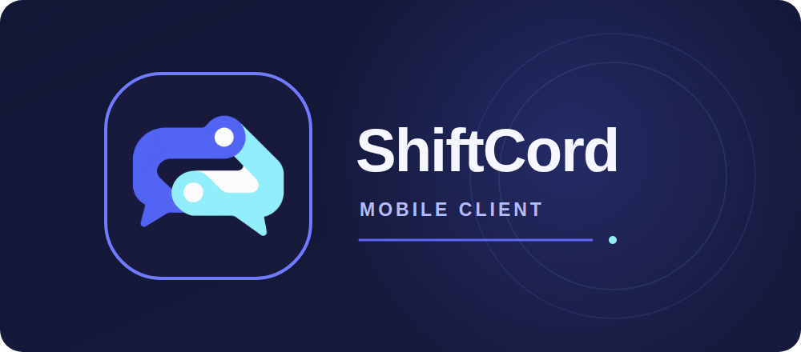

# ShiftCord Mobile

**Plugins, themes and privacy for the Discord app on your Android phone, iPhone and iPad**

[Website](https://10MCord.com) · [ShiftCord PC](https://github.com/10MCord/10MCord) · [ShiftCord Classic](https://github.com/matosdevel0per/10mcord-mobile/tree/main) · [Plugin list](docs/PLUGINS.md)

ShiftCord is on every platform: this repository is the mobile app for **Android** and **iOS / iPadOS**, and
[ShiftCord PC](https://github.com/10MCord/10MCord) covers **Windows, macOS, Linux and the web**.

| | Android | iOS and iPadOS |
| --- | --- | --- |
| **Version** | Android 9 or newer | iOS 16 or newer, Discord 332 or newer |
| **Install with** | ShiftCord \| Installer | An IPA, with Sideloadly, AltStore, SideStore, Feather, KSign or ESign |
| **Root or jailbreak** | Not needed | Not needed |
| **Plugins, themes, fonts** | Yes | Yes |
| **Signed updates** | Yes | Yes |
| **Code** | [`android/`](android) | [`ios/`](ios) |

Both run the same ShiftCord, from [`bundle/`](bundle), so plugins and themes work the same on each.

## Features

- **303 plugins built in.** 261 of them come from ShiftCord PC and 42 are made for phones. They are all off until you
  turn them on, each with its own settings, and you can search and filter them by tag like on desktop. See the
  [full list](docs/PLUGINS.md).
- **Themes and fonts.** Browse community themes and Catppuccin without leaving the app, or add your own. The status
  bar follows your theme.
- **Private by default.** NoTrack is on from the start, so Discord's analytics, telemetry and crash reports are never
  sent.
- **Your language.** English, Türkçe, Русский, Español and Français, following Discord's language or the one you pick.
- **Light on older phones.** Only a list of plugins loads when Discord starts. A plugin's code loads the first time you
  turn it on.
- **Always up to date.** ShiftCord updates itself every time the app starts. On Android, the installer rebuilds it when
  Discord updates.
- **Signed updates.** Every update is signed, and the app checks that signature and refuses older versions, so changing
  the files on the server isn't enough to run code on your phone.
- **Hard to break.** A plugin that fails turns itself off and tells you why, instead of crashing Discord. Safe Mode
  and a recovery menu are always one step away.
- **Compatible.** Vendetta and Revenge plugins and themes work too, and you can browse community plugins in the app.

## Install on Android

No root needed. ShiftCord installs next to Discord as a separate app, and your Discord stays exactly as it is.

1. Download **[ShiftCord | Installer](https://github.com/matosdevel0per/10mcord-mobile/releases/download/next-installer-v1.0.3/10MCord-installer-v1.0.3.apk)**
   and open it. If Android asks, allow your browser to install apps.
2. In **ShiftCord | Installer**, tap **Install**. It uses the Discord on your phone, or downloads the latest one.
3. Open **ShiftCord** and sign in. ShiftCord's settings are in Discord's settings, under **ShiftCord**.

Requires Android 9 or newer. If Google Play Protect warns about the installer, tap **More details → Install anyway**:
it warns about every app that doesn't come from the Play Store.

<b>Rooted? Run ShiftCord inside the real Discord with LSPosed</b>

 

Nothing is reinstalled: the Play Store Discord runs ShiftCord.

1. Install [LSPosed](https://github.com/JingMatrix/LSPosed) or another Xposed framework.
2. Download `10MCord-xposed.apk` from the [`builds-next` branch](https://github.com/matosdevel0per/10mcord-mobile/tree/builds-next)
   and install it.
3. In LSPosed, enable the **ShiftCord Xposed** module for **Discord** (`com.discord`).
4. Force-stop Discord and open it again.

### ZIP usado pelo instalador Android

O instalador busca um único arquivo em `builds-next/10MCord-release.zip` no repositório público. O ZIP deve conter
exatamente `10MCord-xposed.apk`, `10MCord-release.json` e `10MCord-release.sig`; o instalador verifica a assinatura do
manifesto e o hash do APK antes de usá-lo. O workflow `Build` gera esse ZIP após um push para `next` se o secret
`TENMCORD_RELEASE_KEY` do GitHub contiver a chave privada correspondente a `bundle/release-key.pub`. Se você não tiver
essa chave privada, crie um novo par, substitua a chave pública no código e recompile o loader e o instalador antes de
publicar. Se usar outro caminho, defina a propriedade Gradle `10MCord.archiveUrl` ao compilar o instalador. O endereço
padrão só funcionará depois que o repositório e o branch `builds-next` existirem e estiverem públicos.

## Install on iPhone and iPad

No jailbreak needed. iOS 16 or newer.

1. Download **[10MCord.ipa](https://github.com/matosdevel0per/10mcord-mobile/releases/download/ios-v1.0.7/10MCord.ipa)**.
2. Install it with one of these:
   - **[Sideloadly](https://sideloadly.io)** on a computer, with your own Apple ID. Change the bundle ID in its advanced
     options if you want to keep the App Store Discord too.
   - **AltStore or SideStore**, adding this source:
     `https://raw.githubusercontent.com/matosdevel0per/10mcord-mobile/builds-ios/apps.json`
   - **Feather, KSign or ESign**, with a certificate of your own.
3. Open **ShiftCord** and sign in. ShiftCord's settings are in Discord's settings, under **ShiftCord**.

With a free Apple ID the app has to be signed again every 7 days. Shared free certificates can be revoked by Apple at
any time, and everything signed with one then stops opening until it's signed with another.

<b>Jailbroken, or using your own Discord IPA?</b>

 

The [iOS release](https://github.com/matosdevel0per/10mcord-mobile/releases/tag/ios-v1.0.7) also has a rootless `.deb` and
`10MCord.dylib`, to inject into your own decrypted Discord IPA (Discord 332 or newer) with Substrate or ElleKit included.

<b>What doesn't work on iOS?</b>

 

Apple limits sideloaded apps, whichever mod you use: notifications don't arrive while the app is closed or in the
background, and passkeys and sharing to Discord from other apps don't work. SmoothType needs iOS 17 or newer.

## FAQ

<b>Can I use Aliucord plugins?</b>

 

Not in this app. Aliucord plugins are written for the older Discord that Aliucord is built on and can't run on the
current one. [ShiftCord Classic](https://github.com/matosdevel0per/10mcord-mobile/tree/main) runs both ShiftCord's and
Aliucord's plugins, and ShiftCord | Installer can set it up for you.

<b>How do I update?</b>

 

You don't need to do anything for ShiftCord itself: it downloads its newest version every time the app starts. On
Android, when Discord updates, ShiftCord | Installer sends a notification: tap it to rebuild ShiftCord. The installer also
tells you when a new version of itself is out. On iOS, a new Discord comes as a new IPA, which AltStore and SideStore
update for you.

<b>ShiftCord won't start, or a plugin broke something</b>

 

- Shake the phone for the recovery menu, or on Android hold two fingers on the screen for 3 seconds right after ShiftCord
  opens: reload, recovery mode (plugins and themes off), delete the downloaded ShiftCord, or reset the loader settings.
- ShiftCord → General → **Safe Mode** reloads without plugins and themes.
- A plugin that fails to start turns itself off and says so. Turn it back on after the next update.

<b>Will I get banned?</b>

 

Client mods are against Discord's Terms of Service. Bans for using one are rare, but they can happen, so use ShiftCord
at your own risk. Plugins that act for you, like scheduled messages, stay off until you turn them on.

## What's in this repository

| Directory | What it is |
| --- | --- |
| [`bundle/`](bundle) | The ShiftCord that runs inside Discord on both platforms: plugins, themes and settings |
| [`android/`](android) | The Android loader and ShiftCord \| Installer |
| [`ios/`](ios) | The iOS tweak, and its tests |
| [`docs/`](docs) | Development, the plugin list and how to write a plugin |

## Contributing

Bug reports, translations and plugins are welcome: open an issue or come to our
[Discord](https://discord.gg/q5ny7wg9ap). [docs/DEVELOPMENT.md](docs/DEVELOPMENT.md) explains how the repository is laid
out, how to build and test ShiftCord, and how releases work; [docs/PLUGINS.md](docs/PLUGINS.md) shows how to write a
plugin.

## Credits and license

ShiftCord Mobile is a fork of [Revenge](https://github.com/revenge-mod), which continues Bunny and Vendetta, and its iOS
tweak of [RainTweak](https://codeberg.org/raincord/RainTweak); see [UPSTREAM.md](UPSTREAM.md) for the exact upstream
commits. It would not exist without them,
[LSPatch](https://github.com/LSPosed/LSPatch) and the Vendetta tracker mirrors that serve the Discord APKs.
MessageLogger and FakeNitro follow the approaches of the
[Revenge community plugins](https://github.com/revenge-mod/revenge-community-plugins) (GPL-3.0); oneko's cat is
[oneko.js](https://github.com/adryd325/oneko.js) by adryd; ThemeLibrary lists [Catppuccin](https://github.com/catppuccin/vendetta)
and the community [theme marketplace](https://github.com/kmmiio99o/theme-marketplace).

© 2026 rootpoi and contributors. Each directory keeps the license of the project it was forked from: `bundle/`
BSD-3-Clause, `android/loader/` GPL-3.0, `android/installer/` and `ios/` OSL-3.0. ShiftCord's plugins (`bundle/src/plugins`) and the other files
marked `SPDX-License-Identifier: GPL-3.0-or-later` are GPL-3.0-or-later, like ShiftCord PC, so the built bundle as a
whole is distributed under the GPL-3.0. The original copyright notices of Team Vendetta, pylixonly and Team Revenge
are kept in the source files and shown in the installer's About screen.

ShiftCord is not affiliated with or endorsed by Discord Inc., Apple or the Revenge and Rain teams.
